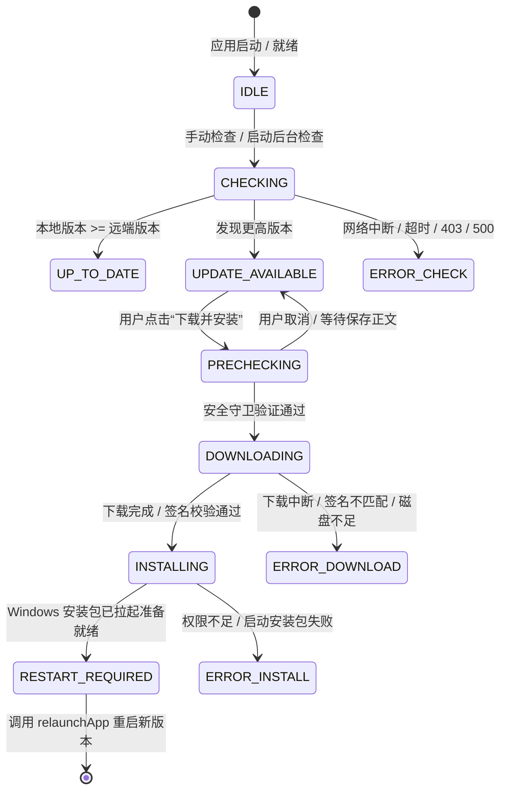

# NovelForge AI — 自动更新与版本发布系统架构设计 (UPDATE_SYSTEM.md)

## 1. 系统定位与设计哲学

NovelForge AI 作为一款专为长篇小说创作者打造的本地优先桌面应用，其自动更新系统必须兼顾：
1. **绝对数据安全 (Data Safety First)**：更新软件绝对不能造成小说正文、人物档案、世界观设定、长期记忆与多 Agent 任务损坏或丢失；
2. **拒绝伪多 Agent 与粗暴杀进程**：正在运行的自动连载与审稿任务必须支持安全挂起、检查点暂存；
3. **真实可运行与防欺骗**：采用真实的 `@tauri-apps/plugin-updater` 原生更新流，真实流式进度计算，严禁假进度条与伪装更新；网络异常时绝不可误报为“已是最新版本”；
4. **强密码学校验**：采用 Tauri 官方推荐的 Minisign 非对称加密签名体系，公钥固化于客户端，私钥由 GitHub Actions 严格加密保护，拒绝不可信恶意更新。

---

## 2. 核心架构与模块划分

```
┌────────────────────────────────────────────────────────┐
│               前端更新交互层 (Presentation)            │
│  UpdateCenter / UpdateStatusCard / UpdateChangelogView │
│         UpdateProgressBar / UpdateSettingsSection      │
└───────────────────────────▲────────────────────────────┘
                            │
┌───────────────────────────┴────────────────────────────┐
│              状态与策略调度层 (Zustand Store)          │
│                    useUpdateStore.ts                   │
│   (维护状态机: IDLE -> CHECKING -> AVAILABLE -> ...)   │
└───────────────────────────▲────────────────────────────┘
                            │
┌───────────────────────────┴────────────────────────────┐
│                    业务服务核心层                      │
│   ┌──────────────────────────┐ ┌────────────────────┐  │
│   │    UpdateService.ts      │ │ DataSafetyGuard.ts │  │
│   │ (Tauri Updater API 适配) │ │ (升级前数据守卫)   │  │
│   └──────────────────────────┘ └────────────────────┘  │
└───────────────────────────▲────────────────────────────┘
                            │
┌───────────────────────────┴────────────────────────────┐
│                    Tauri 原生运行时                    │
│   tauri-plugin-updater  |  tauri-plugin-process (Rust) │
│      Minisign 验签      |   SQLite WAL 在线热备份      │
└────────────────────────────────────────────────────────┘
```

### 2.1 模块职责
- **`UpdateService` (`src/features/updater/services/UpdateService.ts`)**：
  封装 Tauri 2 的 `check()` 与 `downloadAndInstall()`，处理网络超时、403/404/5xx 错误、解析语义化版本，并流式反馈真实下载字节数与速率。
- **`DataSafetyGuard` (`src/features/updater/services/DataSafetyGuard.ts`)**：
  在应用升级安装或重启前，执行 4 步强制安全核验：
  1. 正文编辑器未保存修改检查与一键保存防护；
  2. 检索并安全挂起处于 `RUNNING` 状态的多 Agent 连载任务，保存断点检查点；
  3. 执行 SQLite 数据库在线热备份（生成 `novelforge_pre_update_backup_*.db` 快照）；
  4. 运行 `PRAGMA integrity_check` 完整性诊断，确保数据健康。
- **`ChangelogParser` (`src/features/updater/services/ChangelogParser.ts`)**：
  结构化解析 GitHub Release body，自动归类新增功能、功能优化、Bug 修复、兼容性变更与已知问题，并提供 SemVer 跨版本对比算法。
- **`useUpdateStore` (`src/features/updater/stores/useUpdateStore.ts`)**：
  统一驱动 UI 状态机，维护更新偏好设置，持久化至本地存储，防范重复高频请求。

---

## 3. 更新生命周期状态机



---

## 4. 签名与安全机制

### 4.1 Minisign 非对称加密
- **公钥 (`pubkey`)**：固化在 `src-tauri/tauri.conf.json` 的 `plugins.updater.pubkey` 中，随着客户端一起打包分发；
- **私钥 (`updater.key`)**：
  - 本地生成后严格列入 `.gitignore`，严禁提交至 Git 仓库；
  - 生产发布流水线中，私钥保存在 GitHub Secrets (`TAURI_SIGNING_PRIVATE_KEY`)；
- **签名验证流程**：
  Tauri Updater 在下载新版本 `.zip` 时，会同步拉取其同名的 `.zip.sig` 签名文件。客户端使用公钥验证签名合法性。若文件被篡改或签名伪造，Tauri 原生层直接抛出异常并阻断解压安装。

### 4.2 Windows 平台的退出与安装包运行机制
Windows 下的 Tauri NSIS 安装包更新流程：
1. 下载 `.nsis.zip` 更新压缩包至临时目录；
2. 验证 Minisign 签名与哈希；
3. 执行安装包静默解压并准备拉起更新程序；
4. 调用 `plugin-process` 的 `relaunch()` 或平滑退出，Windows NSIS 更新程序接管并替换可执行程序与资源；
5. 新程序启动时自动继承本地 AppData/Roaming 中的 SQLite 数据库与用户配置。

---

## 5. 本地优先与数据库灾备保障

| 风险场景 | 传统桌面软件缺陷 | NovelForge AI 守护方案 |
| :--- | :--- | :--- |
| **正文未保存即点更新** | 粗暴退出导致几千字草稿丢失 | `DataSafetyGuard` 拦截，弹出确认框，提供一键保存再更新 |
| **多 Agent 连载任务正在生成** | 中途被杀进程导致任务队列损坏 | 自动将 `RUNNING` 任务安全降级为 `PAUSED` 并落盘断点 |
| **新版本数据库 Schema 升级** | 升级失败造成数据库损坏不可逆 | 升级前自动创建 `novelforge_pre_update_backup_*.db` 一致性热备份 |
| **断网或 GitHub 无法访问** | 界面盲目显示“已是最新”欺骗用户 | 明确捕获错误并提示网络异常，提供官方 Release 直达链接 |
