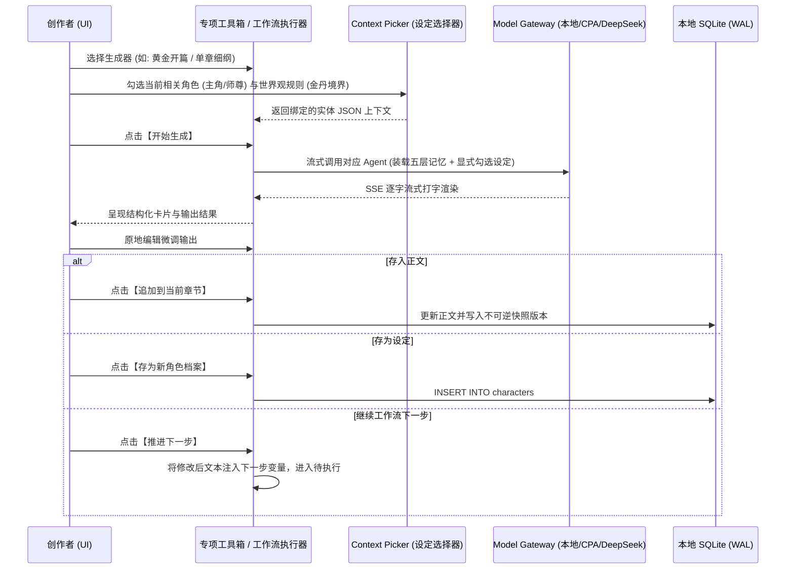

# 首个 P0 功能设计与实施方案报告 (IMPLEMENTATION_REPORT.md)

- **方案编制日期**：2026-10-14
- **实施切片**：**一体化小说专项创作工具箱 (Novelist Toolbox) + 设定集上下文选择器 (Context Picker) + 轻量工作流执行引擎 (Workflow Engine MVP)**
- **版本标记**：NovelForge AI V2.3.0

---

## 1. 架构定位与业务目标

### 1.1 核心痛点解决
1. **解决孤立对话问题**：让小说各个阶段的生成（书名、简介、脑洞、金手指、力量体系、总纲、分卷、细纲、正文、润色）具备结构化卡片与清晰的数据沉淀通道（直接入库为角色卡、规则或章节）；
2. **解决设定关联繁琐问题**：提供沉浸式 Context Picker，允许作者在任何创作任务中一键勾选“关联角色 / 关联词条 / 关联前序章节 / 关联备忘录”；
3. **解决流水线不可控问题**：引入工作流概念，支持“一键执行”与“分步人工推进”，允许作者在每一步原地编辑修订输出，再作为下游步骤的引用变量。

---

## 2. 详细系统设计

### 2.1 数据库结构向下兼容变更 (Schema Migration)
在现有 SQLite 数据库中，以安全向后兼容的方式新增 3 张表：

```sql
-- 1. 工作流模板定义表
CREATE TABLE IF NOT EXISTS workflow_templates (
    id TEXT PRIMARY KEY,
    novel_id TEXT,                    -- 可为空（全局模板）或绑定特定小说
    name TEXT NOT NULL,
    description TEXT,
    category TEXT DEFAULT 'general',  -- general, fantasy, urban, scifi, mystery
    steps_json TEXT NOT NULL,         -- JSON 数组，定义各个步骤及变量绑定
    is_builtin BOOLEAN DEFAULT 0,     -- 是否为系统内置开箱即用工作流
    created_at TIMESTAMP DEFAULT CURRENT_TIMESTAMP,
    updated_at TIMESTAMP DEFAULT CURRENT_TIMESTAMP
);

-- 2. 工作流执行运行实例表
CREATE TABLE IF NOT EXISTS workflow_runs (
    id TEXT PRIMARY KEY,
    template_id TEXT NOT NULL,
    novel_id TEXT NOT NULL,
    target_chapter_id TEXT,           -- 目标关联章节（若涉及正文）
    status TEXT NOT NULL,             -- PENDING, RUNNING, WAITING_STEP, COMPLETED, FAILED, PAUSED
    current_step_index INTEGER DEFAULT 0,
    run_mode TEXT DEFAULT 'STEP',     -- AUTO (一键), STEP (分步人工)
    context_bindings_json TEXT,       -- 绑定的角色ID列表、世界观规则ID列表等
    created_at TIMESTAMP DEFAULT CURRENT_TIMESTAMP,
    updated_at TIMESTAMP DEFAULT CURRENT_TIMESTAMP,
    FOREIGN KEY (novel_id) REFERENCES novels(id) ON DELETE CASCADE
);

-- 3. 工作流单步骤执行记录与输出快照表
CREATE TABLE IF NOT EXISTS workflow_step_records (
    id TEXT PRIMARY KEY,
    run_id TEXT NOT NULL,
    step_index INTEGER NOT NULL,
    step_key TEXT NOT NULL,           -- 如: outline, characters, scene_beat, prose
    title TEXT NOT NULL,
    prompt_rendered TEXT,
    input_values_json TEXT,           -- 用户表单输入与上游引用的实参
    raw_output TEXT,                  -- 模型原始流式输出
    edited_output TEXT,               -- 用户原地人工编辑修订后的文本（作为下游输入）
    status TEXT NOT NULL,             -- PENDING, RUNNING, COMPLETED, FAILED
    error_message TEXT,
    token_usage INTEGER DEFAULT 0,
    created_at TIMESTAMP DEFAULT CURRENT_TIMESTAMP,
    updated_at TIMESTAMP DEFAULT CURRENT_TIMESTAMP,
    FOREIGN KEY (run_id) REFERENCES workflow_runs(id) ON DELETE CASCADE
);

CREATE INDEX IF NOT EXISTS idx_workflow_runs_novel ON workflow_runs(novel_id);
CREATE INDEX IF NOT EXISTS idx_workflow_step_run ON workflow_step_records(run_id, step_index);
```

### 2.2 数据模型与接口契约 (TypeScript & Rust)

```typescript
// 步骤输入配置项
export interface WorkflowStepConfig {
  stepKey: string;
  title: string;
  description: string;
  agentRole: 'editor_in_chief' | 'plot_architect' | 'scene_planner' | 'prose_writer' | 'continuity_auditor' | 'style_editor';
  promptTemplate: string; // 支持 {{inputs.xxx}}, {{step_key.output}}, {{characters}}, {{rules}} 等插槽
  inputs: Array<{
    key: string;
    label: string;
    type: 'text' | 'textarea' | 'select' | 'checkbox';
    placeholder?: string;
    options?: string[];
    required?: boolean;
    defaultValue?: any;
  }>;
  contextBindings?: {
    allowCharacters?: boolean;
    allowWorldRules?: boolean;
    allowPrevChapters?: boolean;
    allowMemos?: boolean;
  };
}

// 专项生成器定义
export interface NovelToolboxAction {
  id: string;
  name: string;
  category: 'idea' | 'character' | 'world' | 'outline' | 'prose' | 'refine';
  icon: string;
  description: string;
  promptTemplate: string;
  destination: 'insert_editor' | 'save_as_character' | 'save_as_rule' | 'save_as_chapter' | 'copy_only';
}
```

### 2.3 数据流转图



---

## 3. 验收标准与测试矩阵

1. **专项工具箱端到端验证**：
   - 测试包含起名、脑洞、金手指、力量体系、黄金开篇、单章细纲、对话精修等至少 8 大生成器；
   - 验证生成完成后，点击【存入角色】能真实在 `characters` 表落库并在角色卡片中展示；
   - 验证点击【追加到正文】能在正文编辑器光标处无缝插入且触发自动保存与版本快照。
2. **设定选择器 (Context Picker) 验证**：
   - 测试能正常拉取当前作品中的全部角色、世界观规则、上一章正文；
   - 勾选后注入 Prompt，在模型日志中核验包含明确的 `【当前出场角色】` 与 `【适用世界法则】`。
3. **工作流单步与断点恢复验证**：
   - 执行“大纲 -> 细纲 -> 正文”三步流水线；
   - 步骤 1 完成后，人工在卡片中编辑修改文本，验证步骤 2 实际接收到了修改后的文本；
   - 模拟网络中断，验证刷新后保留全部已有输出，可点击【从失败处继续执行】。
4. **编译与类型安全验证**：
   - 前端 TypeScript 编译 0 错误；
   - Tauri/Rust 编译 0 警告；
   - 数据库原有 40 项单元测试 100% 保持通过，数据结构完全向下兼容。
