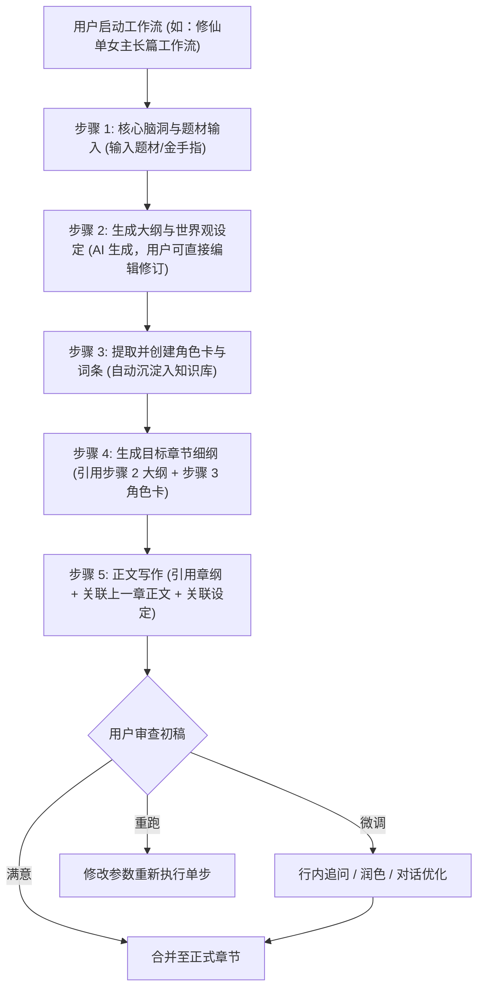

# 星月写作典型用户工作流与交互闭环 (user-workflows.md)

- **研究日期**：2026-10-14
- **证据来源**：`create-cff03331.js`, `execute-new-801489c5.js` 交互逻辑与用户教程

---

## 1. 核心工作流一：从零构思到正文生成的标准工业流水线

### 1.1 数据交接与变量引用机制 [FACT-SOURCE]
在 `create-cff03331.js` 中，工作流的核心是 **变量声明与引用**：
- 步骤 $i$ 的输入可以声明：`{{input.xxx}}`（用户表单输入）；
- 步骤 $i$ 可以显式声明：`{{step1.output}}`、`{{step2.output}}`（引用前面步骤的输出变量）；
- 步骤 $i$ 可以显式绑定小说上下文：
  - `{{character:主角}}`（关联角色档案）
  - `{{entry:宗门体系}}`（关联世界观词条）
  - `{{chapter:prev}}`（关联前一章节正文）
  - `{{memo:伏笔备忘}}`（关联备忘录）

---

## 2. 核心工作流二：双模式执行与人机仲裁机制 [FACT-SOURCE]

星月写作支持两种差异化执行模式：

### 2.1 一键执行模式 (Full Auto)
- 适合标准化短篇生成或批量生成大纲草案；
- 按依赖拓扑自顶向下连续执行模型调用，直至所有步骤状态更新为 `COMPLETED`；
- 任意步骤失败时自动挂起，保留已有全部输出，提供【从失败处继续执行】。

### 2.2 分步执行模式 (Step-by-Step with Human-in-the-Loop)
- 适合严肃长篇小说创作；
- 步骤 1 执行完成 -> 进入【待执行】或【等待确认】状态；
- **原地修改机制**：界面提供【编辑输出结果】按钮，用户可直接修改大纲或设定，保存后，后续步骤将使用**用户修改后的文本**作为输入，避免“错误随步骤放大”；
- 确认无误后点击【下一步】，继续执行后续步骤。

---

## 3. 点击成本与交互效率评估

| 操作任务 | 星月写作典型交互流程 | 点击跳转次数 | 评价 |
| :--- | :--- | :--- | :--- |
| **执行现成工作流** | 选工作流 -> 填入题材脑洞 -> 点击执行 -> 浏览步骤输出 | 3~4 次 | 极高效率，流水线感强烈 |
| **修改单步生成结果** | 步骤卡片 -> 点击编辑 -> 原地修改文字 -> 保存 -> 继续下一步 | 3 次 | 无缝衔接，无需来回切换页面 |
| **关联已有设定** | 步骤参数区 -> 下拉勾选关联角色/词条 -> 自动填入变量 | 2 次 | 避免重复复制粘贴 |
| **局部正文润色** | 选中段落 -> 浮动快捷菜单 -> 选择优化方向（五感/对话/反转） | 2 次 | 沉浸式，符合直觉 |
